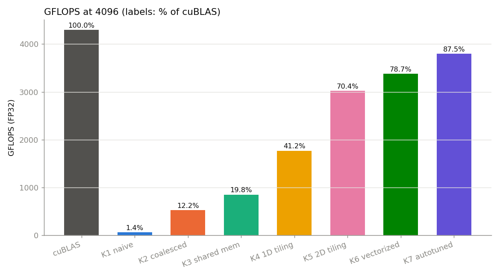
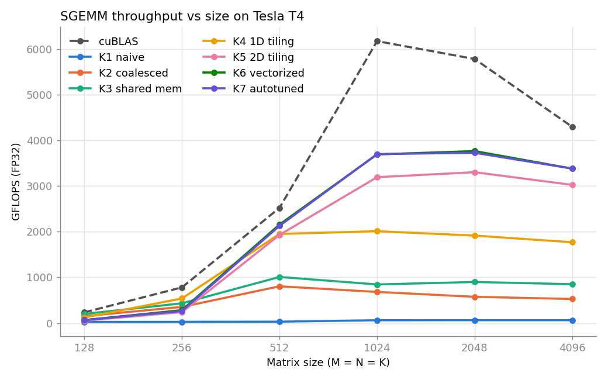
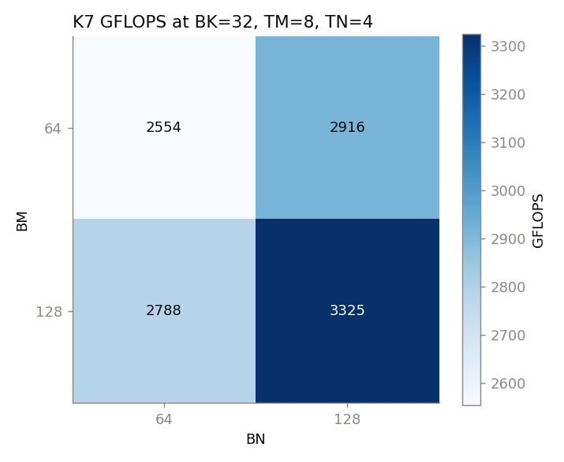
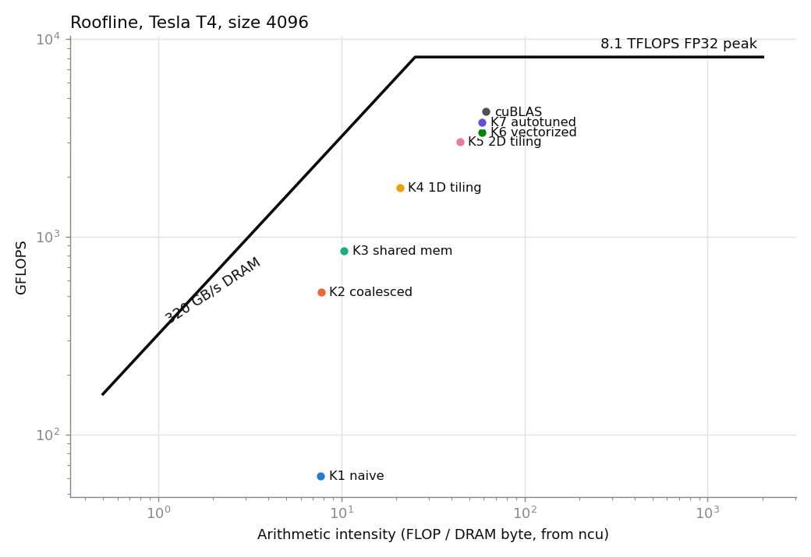

# SGEMM on a Tesla T4: from naive to near-cuBLAS, one optimization at a time

This repo is a worklog of writing FP32 matrix multiplication, `C = alpha*A*B + beta*C` (row-major, square), in CUDA and making it fast on an NVIDIA T4. It goes through seven numbered kernels, each adding exactly one idea: coalescing, shared-memory tiling, 1D then 2D register blocking, vectorized loads with a transposed shared-memory layout, and finally an autotuned tile size. Every kernel is checked against cuBLAS for correctness and timed with CUDA events, and each step is explained with profiler evidence (Nsight Compute counters and `ptxas` resource reports) rather than intuition. A tensor-core (WMMA, FP16-in / FP32-accumulate) kernel is included as a separate, non-comparable stretch goal.

<!-- BEGIN:results_table -->
| Kernel | GFLOPS @ 4096 | % of cuBLAS | Speedup vs previous |
|---|---|---|---|
| cuBLAS (reference) | 4293 | 100.0% |  |
| K1 naive | 62 | 1.4% |  |
| K2 global memory coalescing | 526 | 12.2% | 8.50x |
| K3 shared memory tiling | 850 | 19.8% | 1.62x |
| K4 1D block tiling | 1767 | 41.2% | 2.08x |
| K5 2D block tiling | 3023 | 70.4% | 1.71x |
| K6 vectorized + transposed A | 3379 | 78.7% | 1.12x |
| K7 autotuned | 3380 | 78.7% | 1.00x |
<!-- END:results_table -->



> All numbers in this README are generated from the files in `results/` by `scripts/update_readme.py`. Nothing is typed by hand.

---

## Contents

1. [Setup and reproducing](#1-setup-and-reproducing)
2. [Background](#2-background-what-makes-a-gpu-kernel-fast)
3. [The kernels](#3-the-kernels) - [K1](#k1-naive) · [K2](#k2-global-memory-coalescing) · [K3](#k3-shared-memory-tiling) · [K4](#k4-1d-block-tiling) · [K5](#k5-2d-block-tiling) · [K6](#k6-vectorized-loads-and-a-transposed-a-tile) · [K7](#k7-autotuning-the-tile-sizes) · [K8](#k8-stretch-tensor-cores-with-wmma)
4. [Profiler summary](#4-profiler-summary)
5. [Roofline](#5-roofline)
6. [What didn't work](#6-what-didnt-work)
7. [The remaining gap to cuBLAS](#7-the-remaining-gap-to-cublas)
8. [Interview Q&A](#8-interview-qa)

---

## 1. Setup and reproducing

| | |
|---|---|
| GPU | NVIDIA Tesla T4 (Turing, sm_75), Google Colab free tier |
| SMs / FP32 lanes | 40 SMs x 64 FP32 lanes, ~1.59 GHz boost |
| Peak FP32 | ~8.1 TFLOPS (40 x 64 x 2 FLOP/FMA x 1.59 GHz) |
| DRAM | 16 GB GDDR6, ~320 GB/s |
| Shared memory | 48 KB per block (default), 64 KB per SM |
| Registers | 64K 32-bit registers per SM, at most 255 per thread |
| Max resident threads | 1024 per SM (32 warps) |

<!-- BEGIN:device -->
Measured on: `Tesla T4 (sm_75), 40 SMs, 48 KB smem/block, CUDA runtime 13.0`
<!-- END:device -->

The T4 has no TF32 mode, so cuBLAS `Sgemm` here is a pure FP32 comparison. It is a 70 W card that power-throttles under sustained load, so expect run-to-run variation of a few percent. That is why the harness reports the **median** of 20 timed launches.

**Reproduce on Colab in 3 steps:**

1. Open `colab/run_on_colab.ipynb` in Colab and pick *Runtime -> Change runtime type -> T4 GPU*.
2. Put this repo's URL in the `REPO_URL` cell.
3. *Runtime -> Run all.* It builds, benchmarks, autotunes, profiles, plots, regenerates this README's tables, and downloads `sgemm_results.zip`.

Or locally on any Linux box with CUDA:

```bash
make ARCH=sm_75                                   # bin/sgemm_bench
./bin/sgemm_bench --kernel all --size 4096        # one size, every kernel
./bin/sgemm_bench --kernel 5 --sweep --csv out.csv
bash scripts/run_all.sh && bash scripts/autotune.sh && bash scripts/profile.sh
python scripts/plots.py && python scripts/update_readme.py
```

### How the benchmark works

For each size the harness:

1. Fills A and B with uniform random floats in [-1, 1] from a fixed seed.
2. Runs cuBLAS once to get the reference C. cuBLAS is column-major, so the row-major product is obtained by asking it for `C^T = B^T A^T`, which means passing B first with M and N swapped (see `runCublas` in `src/runner.cuh`).
3. Runs our kernel once and compares it element-wise to the reference. Anything above **1e-2** max absolute error fails loudly and is not timed. Exact equality isn't expected, because a different summation order changes FP32 rounding.
4. Does 3 warm-up launches, then 20 launches each bracketed by `cudaEvent`s, and reports the median.
5. Computes `GFLOPS = 2*M*N*K / time` and `% of cuBLAS` against cuBLAS timed the same way at the same size.

One detail worth knowing: with `beta = 0` the kernels still read C, and `0 * NaN = NaN`. Freshly `cudaMalloc`ed memory can contain NaN bit patterns, so C is zeroed before every correctness run.

<!-- BEGIN:sweep_table -->
| GFLOPS | 128 | 256 | 512 | 1024 | 2048 | 4096 |
|---|---|---|---|---|---|---|
| cuBLAS (reference) | 233 | 780 | 2521 | 6169 | 5778 | 4293 |
| K1 naive | 24 | 26 | 30 | 61 | 62 | 62 |
| K2 global memory coalescing | 151 | 352 | 803 | 680 | 573 | 526 |
| K3 shared memory tiling | 199 | 432 | 1008 | 844 | 898 | 850 |
| K4 1D block tiling | 120 | 538 | 1949 | 2009 | 1913 | 1767 |
| K5 2D block tiling | 51 | 238 | 1928 | 3192 | 3300 | 3023 |
| K6 vectorized + transposed A | 65 | 282 | 2156 | 3690 | 3763 | 3379 |
| K7 autotuned | 65 | 263 | 2126 | 3697 | 3725 | 3380 |

Largest max-abs-error against cuBLAS across all kernels and sizes: 1.60e-04 (tolerance 1e-2).
<!-- END:sweep_table -->

Note that cuBLAS itself peaks at 1024 (6169 GFLOPS) and drops to 4294 GFLOPS at 4096. Each 4096 call takes ~32 ms, long enough for the 70 W T4 to heat up and clock down. The "% of cuBLAS" column at 4096 is therefore against a throttled cuBLAS, and the absolute GFLOPS are the more honest comparison. The autotune run measured its own cuBLAS, so its percentages differ slightly from this table.



---

## 2. Background: what makes a GPU kernel fast

**Memory hierarchy.** From slowest and largest to fastest and smallest:

```
DRAM (global memory)   16 GB    ~320 GB/s     hundreds of cycles latency
L2 cache                4 MB    shared by all SMs
L1 / shared memory     64 KB    per SM, ~tens of cycles; shared memory is a
                                programmer-managed scratchpad split into 32 banks
Registers             256 KB    per SM (64K x 4 B), private to a thread, ~1 cycle
```

Most of this project moves data reuse *up* the hierarchy: each value is read from DRAM once, reused many times from shared memory, and many more times from registers.

**Warps.** Threads execute in groups of 32 called warps, which issue one instruction at a time. When a warp loads from global memory, the hardware looks at the 32 addresses together and fetches the 32-byte sectors that cover them. 32 consecutive floats (128 bytes) take 4 sectors, which is the best case and is called *coalesced*. 32 floats that are each `N*4` bytes apart take 32 separate sectors, and most of each one is thrown away. The same instruction can be 8x more expensive just because of *which thread reads which address*.

**Memory-bound vs compute-bound.** Each kernel has an *arithmetic intensity*: FLOPs done per byte moved. The T4 can do 8.1 TFLOP/s but only move 320 GB/s, so it needs about **25 FLOP per DRAM byte** (the "ridge point") to keep the math units busy. Below that, a kernel is memory-bound and faster math won't help. Above it, it is compute-bound and the remaining question is how well the FMA units are fed. A 4096^3 GEMM does 2 x 4096^3 = 137 GFLOP and must at minimum read A and B and write C (3 x 64 MB). The *best possible* intensity is therefore ~700 FLOP/byte, so GEMM is compute-bound in principle. Each kernel below gets closer to that in practice.

**Occupancy.** An SM hides latency by switching between resident warps. How many warps fit is limited by registers (64K per SM), shared memory (64 KB per SM), and the 1024-thread cap. A kernel that uses 128 registers per thread can have at most 512 threads resident (64K / 128). Higher occupancy is not always better, though. Kernels K5-K7 deliberately trade occupancy for more work per thread.

---

## 3. The kernels

Notation used throughout: the output C is `M x N`, the shared dimension is `K`. A block computes a `BM x BN` tile of C, walks along K in steps of `BK`, and each thread computes a `TM x TN` patch.

### K1: naive

**Idea.** One thread per output element: thread `(row, col)` does a dot product of row `row` of A with column `col` of B. 32x32 blocks.

The deliberate mistake is that `threadIdx.x` maps to the **row**.

```
warp = 32 threads with consecutive threadIdx.x = 32 consecutive ROWS, same col

         B (K x N, row-major)                 C
   col ->  .  .  X  .  .              row 0  . . X . .   <- thread 0
           .  .  X  .  .              row 1  . . X . .   <- thread 1
           .  .  X  .  .              ...
  every thread in the warp reads the same B[k][col] (broadcast, fine),
  but A[row][k] for 32 different rows (32 addresses K*4 bytes apart)
  and writes C[row][col] down a column (32 addresses N*4 bytes apart).
```

```cuda
int row = blockIdx.x * blockDim.x + threadIdx.x;
int col = blockIdx.y * blockDim.y + threadIdx.y;
for (int k = 0; k < K; k++) {
    sum += A[row * K + k] * B[k * N + col];
}
```

<!-- BEGIN:k1_result -->
**Measured at 4096:** 62 GFLOPS, 1.4% of cuBLAS (median of 20 runs, 2221.97 ms).
<!-- END:k1_result -->

**Why it's slow.** Every A load in a warp is spread over 32 rows, so each one becomes 32 separate memory transactions. Almost all of every 32-byte sector fetched is wasted. L1/L2 hide some of this because the next `k` hits the same lines, but the kernel is still limited by memory transactions, not arithmetic. ncu shows it in the [profiler table](#4-profiler-summary) as very low SM throughput.

### K2: global memory coalescing

**Idea.** Same arithmetic, same 1024 threads per block. Only the thread-to-output mapping changes, so that the 32 threads of a warp share a row and cover 32 consecutive columns.

```cuda
// 1D block of 1024 threads, one 32x32 tile of C
int row = blockIdx.x * 32 + threadIdx.x / 32;
int col = blockIdx.y * 32 + threadIdx.x % 32;
```

```
warp w = threads 32w .. 32w+31  ->  row w of the tile, cols 0..31

   B[k][col0 .. col0+31]  = 128 contiguous bytes  -> 4 sectors, 1 request
   A[row][k]              = same address for all 32 threads -> broadcast
   C[row][col0 .. +31]    = 128 contiguous bytes  -> coalesced store
```

<!-- BEGIN:k2_result -->
**Measured at 4096:** 526 GFLOPS, 12.2% of cuBLAS, 8.50x over K1 (median of 20 runs, 261.47 ms).
<!-- END:k2_result -->

**Why it matters.** A warp's memory instruction is serviced as a set of 32-byte sectors. After the change, a warp's B load touches 4 sectors instead of up to 32, so the same DRAM and L2 bandwidth delivers many more useful bytes. No arithmetic changed. This is the clearest demonstration in the project that on a GPU the access pattern of the *warp*, not the thread, is what counts.

### K3: shared memory tiling

**Idea.** A block computes a 32x32 tile of C. It walks along K in 32-wide steps. At each step the block cooperatively copies a 32x32 tile of A and a 32x32 tile of B into shared memory, and every thread then reads from there. Each value loaded from global memory is now reused by 32 threads.

```
         K ->                      B tile (32 x 32)
   A  [ As ][    ][    ]           [ Bs ]
      [    ]                       [    ]
                                   [    ]
   tileStart = 0, 32, 64, ...: load As, Bs  -> sync -> 32 FMAs -> sync
```

```cuda
As[threadRow][threadCol] = A[row * K + tileStart + threadCol];
Bs[threadRow][threadCol] = B[(tileStart + threadRow) * N + col];
__syncthreads();   // 1: tile fully loaded before anyone reads it
for (int k = 0; k < TILE; k++) {
    sum += As[threadRow][k] * Bs[k][threadCol];
}
__syncthreads();   // 2: nobody overwrites the tile while others still read it
```

**The two `__syncthreads()`.** The first is needed because thread `t` reads `As[threadRow][k]` for all `k`, i.e. values written by 31 *other* threads. Without the barrier it could read before they have written. The second is needed because the loop wraps around and starts overwriting `As`/`Bs` with the next tile. A fast warp would otherwise clobber data that a slow warp is still using for the current tile.

<!-- BEGIN:k3_result -->
**Measured at 4096:** 850 GFLOPS, 19.8% of cuBLAS, 1.62x over K2 (median of 20 runs, 161.76 ms).
<!-- END:k3_result -->

**Why it helps less than you'd expect.** DRAM traffic falls by roughly the tile width, but look at the inner loop: every FMA needs **two shared-memory loads** (`As[threadRow][k]` and `Bs[k][threadCol]`). Shared memory is fast but not free. Its bandwidth per SM is a fixed number of bytes per cycle, and at 2 loads per FMA the load/store pipeline, not the FMA units, sets the speed. The bottleneck moved from DRAM to shared memory. The next two kernels attack the *loads per FMA* ratio.

### K4: 1D block tiling

**Idea.** Give each thread more than one output so it can reuse operands from **registers**. Tile sizes BM=64, BN=64, BK=8, TM=8, giving (64x64)/8 = 512 threads per block. Each thread computes 8 vertically stacked outputs of one column, kept in `threadResults[8]`.

```
 block tile of C (64 x 64), 512 threads

   col:  0   1   2  ...  63
       +---+---+---+   +---+
 rows  | t0| t1| t2|...|t63|   thread t owns column t % 64,
 0..7  |   |   |   |   |   |   rows (t / 64) * 8 .. +7
       +---+---+---+   +---+
 rows  |t64|t65|   |   |   |
 8..15 |   |   |   |   |   |
       ...
```

Loading is simple because the A tile (64x8) and the B tile (8x64) both have exactly 512 elements, so every thread loads one element of each.

```cuda
for (int k = 0; k < BK; k++) {
    float bValue = Bs[k * BN + threadCol];          // one load...
    for (int i = 0; i < TM; i++) {
        threadResults[i] += As[(threadRow * TM + i) * BK + k] * bValue;   // ...reused 8 times
    }
}
```

**Arithmetic intensity per thread.** Per `k` a thread now does 8 FMAs for 9 shared loads (1 B + 8 A), versus 1 FMA for 2 loads in K3. That is ~0.9 FMA/load vs 0.5. Global loads per block per K-step are (64+64)x8 floats for 64x64x8 FMAs, a 2x improvement over the 32x32 tile.

<!-- BEGIN:k4_result -->
**Measured at 4096:** 1767 GFLOPS, 41.2% of cuBLAS, 2.08x over K3 (median of 20 runs, 77.76 ms).
<!-- END:k4_result -->

### K5: 2D block tiling

**Idea.** Go two-dimensional. BM=BN=128, BK=8, TM=TN=8, giving (128x128)/(8x8) = **256 threads**, each computing an **8x8** patch of C held in 64 registers.

The inner loop is an **outer product**. For each `k`, load a column of 8 A values into `regM` and a row of 8 B values into `regN`, then do all 8x8 = 64 multiply-adds between them:

```
                regN[0..7]  (row k of the B tile, 8 values)
               [b0 b1 b2 b3 b4 b5 b6 b7]
  regM  a0  [  a0b0 a0b1 ...         a0b7 ]
  [0..7] a1 [  a1b0  .                .   ]    threadResults[8][8] += regM (x) regN
        ... [   .         64 FMAs     .   ]
        a7  [  a7b0  ...             a7b7 ]
```

```cuda
for (int k = 0; k < BK; k++) {
    for (int i = 0; i < TM; i++) regM[i] = As[(threadRow * TM + i) * BK + k];
    for (int j = 0; j < TN; j++) regN[j] = Bs[k * BN + threadCol * TN + j];
    for (int i = 0; i < TM; i++)
        for (int j = 0; j < TN; j++)
            threadResults[i * TN + j] += regM[i] * regN[j];
}
```

Each tile now has 128x8 = 1024 elements but there are only 256 threads, so each thread loads 4 elements of each tile in a strided loop (`offset += numThreads / BK` rows for A, `numThreads / BN` rows for B).

**Why this is the big jump.** Per `k`, a thread does **64 FMAs for 16 shared loads** (4 FMA/load, vs 0.9 in K4 and 0.5 in K3). Per block per K-step, global traffic is (128+128)x8 floats for 128x128x8 FMAs, another 2x better than K4. The kernel finally spends most of its issue slots on FMAs. The cost is registers: 64 accumulators + 16 cached operands + addressing means ~100+ registers per thread (see the [resource table](#4-profiler-summary)), so occupancy falls. That trade is the theme of K7.

<!-- BEGIN:k5_result -->
**Measured at 4096:** 3023 GFLOPS, 70.4% of cuBLAS, 1.71x over K4 (median of 20 runs, 45.47 ms).
<!-- END:k5_result -->

### K6: vectorized loads and a transposed A tile

**Idea.** Same tiling as K5 with three changes:

1. **Global loads use `float4`.** One 128-bit load instruction instead of four 32-bit ones. The A tile is 128 rows x 2 float4, and the B tile 8 rows x 32 float4. Both are exactly 256 float4s, so every thread issues one vector load per tile. This is legal because rows start at multiples of 4 floats (N and K are multiples of 128) and `cudaMalloc` returns 256-byte aligned pointers.
2. **The A tile is stored transposed: `As[BK][BM]`.** In the inner loop a thread needs `A[threadRow*8 + 0..7][k]` for a fixed `k`. In K5's `As[row][k]` layout those 8 values are 8 floats apart (stride BK), so they need 8 separate scalar loads. Transposed, they are 8 *consecutive* floats, so two `LDS.128` vector loads fetch them:

   ```
   K5  As[row][k]:   row0: k0 k1 .. k7 | row1: k0 k1 .. k7 | ...   needed: column k  (stride 8)
   K6  As[k][row]:   k0: r0 r1 r2 .. r127 | k1: r0 r1 .. | ...    needed: row k slice (contiguous)
   ```
3. **The C store uses `float4`** as well (8 rows x 2 float4 per thread).

```cuda
float4 aVec = reinterpret_cast<const float4*>(&aBlock[aLoadRow * K + tileStart + aLoadCol * 4])[0];
As[aLoadCol * 4 + 0][aLoadRow] = aVec.x;     // transpose while storing to smem
As[aLoadCol * 4 + 1][aLoadRow] = aVec.y;
...
float4 aValues = reinterpret_cast<const float4*>(&As[k][threadRow * TM + i])[0];  // LDS.128
```

**Bank conflicts.** Shared memory has 32 banks, each 4 bytes wide; address `a` lives in bank `(a / 4) % 32`. A warp's shared-memory request is served in one pass if all threads hit different banks *or* the same address (broadcast). If `n` threads hit *different addresses in the same bank*, the request is replayed `n` times (an n-way conflict). In K5 a warp spans two values of `threadRow`. For the A reads the two addresses are `(threadRow*8 + i)*8 + k` and `((threadRow+1)*8 + i)*8 + k`, which are 64 floats apart: same bank, different address, so a 2-way conflict on every A load. In K6 the same two reads are 8 floats apart and land in different banks. The transpose *store* (`As[aLoadCol*4 + c][aLoadRow]`) is not free either: consecutive threads write with a stride of one row of `As`, so the store side is where to look for new conflicts. **What ncu actually showed.** The transpose helped less than I expected. Shared-load bank conflicts at 4096 went from 301,989,888 (K5) to 268,435,456 (K6), only ~11% fewer, and the transposed store added 16,777,216 store conflicts (see the [profiler table](#4-profiler-summary)). Dividing by the work explains why. There are 8,192 warps x 4,096 inner-loop iterations, which works out to ~9 conflicts per iteration in K5 and 8 in K6, so A was never the main source. The conflicts come from the **B** reads. The 16 threads across a warp read `Bs[k][threadCol*8 .. +7]`, so their addresses are 8 floats apart and only 4 distinct groups of banks get used: a 4-way conflict on every B load, in K5 and K6 alike. The autotune sweep confirms this independently (see K7): with TM=8, configs with TN=4, where neighbouring threads' B reads are contiguous, beat TN=8 at every tile size.

<!-- BEGIN:k6_result -->
**Measured at 4096:** 3379 GFLOPS, 78.7% of cuBLAS, 1.12x over K5 (median of 20 runs, 40.67 ms).
<!-- END:k6_result -->

### K7: autotuning the tile sizes

**Idea.** K6's tile sizes were picked by hand. K7 is K6 rewritten as `template <int BM, int BN, int BK, int TM, int TN>`, which is the only template in the project. They have to be compile-time constants, because they size the shared and register arrays and let the compiler fully unroll the inner loops. Every point of the grid

| BM | BN | BK | TM | TN |
|---|---|---|---|---|
| 64, 128 | 64, 128 | 8, 16, 32 | 4, 8 | 4, 8 |

is checked against three constraints (`isValidTileConfig` in `runner.cuh`, mirrored in `scripts/autotune.sh`):

- threads per block = BM*BN/(TM*TN) must be in [64, 1024]
- the A and B tiles must split evenly over the threads in float4 units, i.e. `(BM*BK/4) % threads == 0` and `(BK*BN/4) % threads == 0`
- shared memory `(BM*BK + BK*BN)*4` bytes must fit in 48 KB

That leaves 35 of the 48 combinations. All 35 are instantiated into the one binary through a table of function pointers (`AUTOTUNE_CONFIGS`), so the sweep needs one build rather than 35. `scripts/autotune.sh` runs each at 4096 and writes `results/autotune.csv`. The winner is copied into `K7_BM..K7_TN` in `runner.cuh` and becomes the official K7.

Fastest configurations:

<!-- BEGIN:autotune_best -->
| BM | BN | BK | TM | TN | threads | GFLOPS | % cuBLAS |
|---|---|---|---|---|---|---|---|
| 128 | 128 | 32 | 8 | 4 | 512 | 3325 | 93.5% |
| 128 | 128 | 16 | 8 | 4 | 512 | 3245 | 93.1% |
| 128 | 128 | 16 | 8 | 8 | 256 | 3201 | 90.9% |
| 128 | 128 | 8 | 8 | 8 | 256 | 3179 | 92.2% |
| 128 | 128 | 32 | 8 | 8 | 256 | 3137 | 88.2% |

35 valid configurations were measured at size 4096.
<!-- END:autotune_best -->

**What the sweep says.** The winner is BM=BN=128, BK=32, TM=8, TN=4 (512 threads) at 3325 GFLOPS. In the same run, K6's hand-picked 128x128x8 / 8x8 got 3179, so the tuned config is ~4.6% faster. Three patterns stand out in `results/autotune.csv`:

- **TM=4 loses.** Every one of the 13 slowest configs has TM=4: a 4-row thread tile halves the FMA-per-shared-load ratio.
- **With TM=8, TN=4 beats TN=8** at every tile size (e.g. 128x128x32: 3325 vs 3137 GFLOPS; 64x128x32: 2916 vs 2700). With TN=4 each thread reads 4 B values and neighbours read the next 4, so a warp's B reads are contiguous and avoid the 4-way bank conflict described in K6.
- **Big tiles win, and BK=32 helps them.** Fewer, longer K-steps mean fewer `__syncthreads()` per FLOP. The winner uses 64 registers per thread (`resource_usage.txt`), so exactly two 512-thread blocks fill the T4's 64K-register file and 1024-thread limit, and 2 x 32 KB of shared memory fits in 64 KB.



<!-- BEGIN:k7_result -->
**Measured at 4096:** 3380 GFLOPS, 78.7% of cuBLAS, 1.00x over K6 (median of 20 runs, 40.67 ms).
<!-- END:k7_result -->

**The trade-off.** Bigger tiles mean more reuse. A BMxBN block tile loads (BM+BN)xBK floats per K-step to do BMxBNxBK FMAs, and a TMxTN thread tile does TMxTN FMAs per TM+TN shared loads. But both cost resources:

- **Registers.** A thread holds TMxTN accumulators plus TM+TN operands. An 8x8 thread tile needs 100+ registers (see below). At ~128 registers per thread the T4 fits at most 512 threads per SM (64K / 128). The per-config register counts are in the resource table.
- **Shared memory.** BK=32 with 128x128 tiles is 32 KB per block, so only 2 blocks fit in 64 KB per SM. Larger BK also means fewer, longer K-steps (fewer `__syncthreads()`), which is why it can still win.
- **Tail effects.** A 4096^2 C with 128x128 tiles is 1024 blocks. On 40 SMs that is 25.6 waves, so the last wave is partly idle. With 64x64 tiles it is 4096 blocks, and the tail is relatively smaller.

There is no closed-form winner, which is why it's measured. Registers per thread for each kernel come from `nvcc -Xptxas -v` (written by `scripts/profile.sh` to `results/resource_usage.txt`):

<!-- BEGIN:resource_table -->
From `ptxas resource usage, arch=sm_75 (Build cuda_13.0.r13.0/compiler.36424714_0)`:

|  | kernel | registers / thread | static smem (bytes) | spill stores (bytes) |
|---|---|---|---|---|
| K1 | sgemm_naive | 52 | 0 | 0 |
| K2 | sgemm_coalesced | 53 | 0 | 0 |
| K3 | sgemm_shared_mem | 41 | 8192 | 0 |
| K4 | sgemm_1d_blocktiling | 64 | 4096 | 0 |
| K5 | sgemm_2d_blocktiling | 119 | 8192 | 0 |
| K6 | sgemm_vectorized | 101 | 8192 | 0 |
| K7 | autotuned<128,128,32,4,4> | 58 | 32768 | 0 |
| K7 | autotuned<128,64,32,4,4> | 58 | 24576 | 0 |
| K7 | autotuned<64,64,16,4,4> | 60 | 8192 | 0 |
| K7 | autotuned<64,128,32,4,4> | 62 | 24576 | 0 |
| K7 | autotuned<64,64,32,4,4> | 62 | 16384 | 0 |
| K7 | autotuned<128,128,32,8,4> | 64 | 32768 | 0 |
| K7 | autotuned<64,64,16,4,8> | 64 | 8192 | 0 |
| K7 | autotuned<64,64,8,8,4> | 64 | 4096 | 0 |
| K7 | autotuned<128,128,32,4,8> | 65 | 32768 | 0 |
| K7 | autotuned<128,128,16,8,4> | 65 | 16384 | 0 |
| K7 | autotuned<128,64,16,8,4> | 65 | 12288 | 0 |
| K7 | autotuned<64,128,16,8,4> | 65 | 12288 | 0 |
| K7 | autotuned<64,64,16,8,4> | 65 | 8192 | 0 |
| K7 | autotuned<64,64,8,4,8> | 65 | 4096 | 0 |
| K7 | autotuned<128,128,16,4,8> | 66 | 16384 | 0 |
| K7 | autotuned<128,64,16,4,8> | 67 | 12288 | 0 |
| K7 | autotuned<64,128,16,4,8> | 67 | 12288 | 0 |
| K7 | autotuned<64,128,32,4,8> | 72 | 24576 | 0 |
| K7 | autotuned<128,64,32,8,4> | 73 | 24576 | 0 |
| K7 | autotuned<128,64,32,4,8> | 73 | 24576 | 0 |
| K7 | autotuned<64,64,32,4,8> | 74 | 16384 | 0 |
| K7 | autotuned<64,128,32,8,4> | 77 | 24576 | 0 |
| K7 | autotuned<64,64,32,8,4> | 77 | 16384 | 0 |
| K7 | autotuned<128,64,8,8,8> | 99 | 6144 | 0 |
| K7 | autotuned<64,128,16,8,8> | 100 | 12288 | 0 |
| K7 | autotuned<128,128,16,8,8> | 101 | 16384 | 0 |
| K7 | autotuned<128,128,8,8,8> | 101 | 8192 | 0 |
| K7 | autotuned<128,64,16,8,8> | 101 | 12288 | 0 |
| K7 | autotuned<64,128,8,8,8> | 101 | 6144 | 0 |
| K7 | autotuned<64,64,8,8,8> | 103 | 4096 | 0 |
| K7 | autotuned<128,128,32,8,8> | 105 | 32768 | 0 |
| K7 | autotuned<64,64,16,8,8> | 106 | 8192 | 0 |
| K7 | autotuned<64,128,32,8,8> | 121 | 24576 | 0 |
| K7 | autotuned<128,64,32,8,8> | 122 | 24576 | 0 |
| K7 | autotuned<64,64,32,8,8> | 138 | 16384 | 0 |
| K8 | sgemm_wmma_fp16 | 72 | 0 | 0 |
<!-- END:resource_table -->

### K8 (stretch): tensor cores with WMMA

> **Not comparable to K1-K7.** K8 reads A and B in **FP16**, multiplies on tensor cores, and accumulates in FP32. Its inputs carry ~3 decimal digits instead of ~7. It is compared only against `cublasGemmEx` with the same types (FP16 in, FP32 compute, FP32 out), in its own table.

Turing tensor cores do a 16x16x16 matrix multiply-accumulate per warp instruction sequence, exposed in CUDA as `nvcuda::wmma`. The kernel uses 4 warps per block arranged 2x2, so the block tile is 64x64. Each warp owns a 32x32 piece of C, i.e. 2x2 accumulator fragments. Fragments are loaded straight from global memory (no shared-memory staging), which keeps the kernel short and readable but leaves performance on the table.

```cuda
for (int k = 0; k < K; k += 16) {
    for (int i = 0; i < 2; i++) wmma::load_matrix_sync(aFrag[i], A + (tileRow + i*16) * K + k, K);
    for (int j = 0; j < 2; j++) wmma::load_matrix_sync(bFrag[j], B + k * N + tileCol + j*16, N);
    for (int i = 0; i < 2; i++)
        for (int j = 0; j < 2; j++)
            wmma::mma_sync(accFrag[i][j], aFrag[i], bFrag[j], accFrag[i][j]);
}
```

Which thread holds which element of a fragment is unspecified, so everything goes through the warp-wide `*_sync` calls. The epilogue applies alpha/beta element-wise, which is valid because the accumulator fragment and the loaded C fragment share the same layout.

<!-- BEGIN:fp16_table -->
| size | cublasGemmEx FP16->FP32 GFLOPS | K8 WMMA GFLOPS | % of cublasGemmEx | max abs error |
|---|---|---|---|---|
| 128 | 290 | 262 | 90.2% | 0.0e+00 |
| 256 | 1478 | 1364 | 92.3% | 1.9e-05 |
| 512 | 12548 | 5072 | 40.4% | 3.8e-05 |
| 1024 | 30869 | 6636 | 21.5% | 0.0e+00 |
| 2048 | 40528 | 4927 | 12.2% | 0.0e+00 |
| 4096 | 19685 | 4258 | 21.6% | 0.0e+00 |
<!-- END:fp16_table -->

The obvious next steps are staging A/B tiles in shared memory, so each fragment load isn't a strided global read, and giving each warp a larger tile.

---

## 4. Profiler summary

`scripts/profile.sh` profiles one steady-state launch of each kernel at 4096 with Nsight Compute. It skips the correctness launch and warm-ups with `--launch-skip 4 --launch-count 1`. On Colab, `ncu` can fail with `ERR_NVGPUCTRPERM` because the VM doesn't expose performance counters. The script then prints instructions for a rented Linux GPU, where `sudo ncu` works, and still writes the `ptxas` resource report.

<!-- BEGIN:ncu_table -->
| Kernel | time (ms) | DRAM read (MB) | DRAM write (MB) | SM % | DRAM % | achieved occupancy % | smem ld bank conflicts | smem st bank conflicts |
|---|---|---|---|---|---|---|---|---|
| cuBLAS (reference) | 47.49 | 2148 | 85 | 96.7 | 14.7 | 48.9 | 126447 | 3763024 |
| K1 naive | 6066.37 | 17764 | 86 | 6.0 | 0.9 | 98.1 | 0 | 0 |
| K2 global memory coalescing | 423.01 | 17646 | 85 | 86.8 | 13.1 | 98.3 | 0 | 0 |
| K3 shared memory tiling | 331.85 | 13178 | 85 | 76.1 | 12.5 | 100.0 | 0 | 0 |
| K4 1D block tiling | 141.12 | 6505 | 84 | 57.0 | 14.6 | 99.6 | 0 | 0 |
| K5 2D block tiling | 76.34 | 3016 | 83 | 61.1 | 12.7 | 49.3 | 301989888 | 0 |
| K6 vectorized + transposed A | 70.81 | 2256 | 81 | 65.1 | 10.3 | 49.3 | 268435456 | 16777216 |
| K7 autotuned | 70.81 | 2257 | 81 | 65.1 | 10.3 | 49.3 | 268435456 | 16777216 |

(ncu locks clocks to base frequency, so its times are longer than the harness timings.)
<!-- END:ncu_table -->

Top warp stall reasons:

<!-- BEGIN:stall_table -->
| Kernel | Top stall reason | 2nd | 3rd |
|---|---|---|---|
| cuBLAS (reference) | not_selected (2.18) | math_pipe_throttle (2.17) | selected (1.00) |
| K1 naive | lg_throttle (436.70) | long_scoreboard (4.28) | not_selected (2.93) |
| K2 global memory coalescing | lg_throttle (23.76) | not_selected (3.12) | wait (2.44) |
| K3 shared memory tiling | mio_throttle (28.27) | long_scoreboard (5.30) | not_selected (3.43) |
| K4 1D block tiling | mio_throttle (15.37) | long_scoreboard (3.48) | barrier (3.27) |
| K5 2D block tiling | mio_throttle (3.76) | not_selected (1.18) | wait (1.03) |
| K6 vectorized + transposed A | mio_throttle (3.07) | short_scoreboard (1.26) | not_selected (1.05) |
| K7 autotuned | mio_throttle (3.07) | short_scoreboard (1.26) | not_selected (1.05) |

(cycles stalled per issued instruction, from the WarpStateStats section)
<!-- END:stall_table -->

How to read the stall reasons. **long_scoreboard** is a warp waiting on a global/local memory load, typical of K1-K2. **mio_throttle / short_scoreboard** is a warp waiting on shared memory, the K3 signature. **math_pipe_throttle / not_selected** means the FMA pipe is busy, which is what you want to see in K5-K7. **barrier** is time spent in `__syncthreads()`.

---

## 5. Roofline



The roofline plots each kernel's achieved GFLOPS against its arithmetic intensity: FLOPs / (DRAM bytes read + written), with the DRAM bytes measured by ncu. The two roofs are the T4's 320 GB/s memory slope and its 8.1 TFLOPS compute ceiling, meeting at ~25 FLOP/byte.

What to expect and look for:

- **K1** reads far more DRAM bytes than the 192 MB minimum, and its warps are mostly waiting on memory transactions, not DRAM *bandwidth*. It sits well below *both* roofs, which is the signature of a latency/transaction-bound kernel rather than a bandwidth-bound one.
- **K2 sits at almost the same intensity as K1.** ncu shows practically the same DRAM traffic (17,646 MB vs 17,764 MB read), because L2 was already absorbing K1's scattered reads. The 8.5x speed-up came from fewer L1 / load-store transactions, not fewer DRAM bytes. K1's top stall reason is `lg_throttle` (the global load/store queue is full) at 436.7 cycles per instruction, versus 23.8 for K2. **K3** cuts DRAM reads to 13,178 MB, and its top stall becomes `mio_throttle`: waiting on the shared-memory pipe, exactly the bottleneck predicted in the K3 section.
- **K4-K7** have high enough intensity that DRAM is no longer the issue. They are compute-side kernels, and the remaining distance to the 8.1 TFLOPS roof is instruction overhead (address math, shared loads, syncs) and latency that occupancy cannot hide.
- **cuBLAS** shows how close to the compute roof a production kernel gets on this card under sustained clocks. The T4 rarely holds its 1.59 GHz boost for long at 70 W, so even cuBLAS stays below the theoretical peak.

---

## 6. What didn't work

**Small thread tiles.** I expected 128x128 tiles with 4x4 per thread (1024 threads) to be competitive: more threads, more parallelism. It came 14th of 35 (2723 GFLOPS vs 3325 for the winner), and every one of the 13 slowest configs has TM=4. A 4x4 outer product does 16 FMAs for 8 shared loads (2 FMA/load), versus 64 for 16 (4 FMA/load) at 8x8. That halves the compute-to-load ratio, which was the whole point of K5. The very worst combine TM=4 with TN=8, which also has the B-read bank conflict. The bottom of the sweep:

<!-- BEGIN:autotune_worst -->
| BM | BN | BK | TM | TN | threads | GFLOPS | % cuBLAS |
|---|---|---|---|---|---|---|---|
| 64 | 64 | 32 | 4 | 8 | 128 | 1948 | 53.7% |
| 64 | 64 | 16 | 4 | 8 | 128 | 2020 | 55.0% |
| 64 | 64 | 8 | 4 | 8 | 128 | 2024 | 53.6% |
<!-- END:autotune_worst -->

**Expecting K3 to be a big win.** Shared memory is "the" textbook optimization, but at one output per thread it only moves the bottleneck from DRAM to the shared-memory pipe (2 loads per FMA). The real gains only came once each thread computed many outputs from registers (K4, K5).

**Transposing A to remove bank conflicts.** The K6 transpose was meant to fix shared-memory bank conflicts. ncu says load conflicts fell only ~11% (302M -> 268M), and the transposed store added 16.8M store conflicts, because most conflicts were on the B reads (see K6). K6 still beat K5 (3379 vs 3023 GFLOPS), but that came from issuing fewer, wider load instructions (float4 global loads, `LDS.128`), not from fewer conflicts. The change that actually removed the B conflict was found by the autotuner: TN=4.

**NaN results with beta = 0.** An early harness version did not zero C before the first launch. Uninitialised device memory sometimes holds NaN bit patterns, and `0.0f * NaN` is NaN, so a correct kernel could fail the check depending on what was left in that memory. The fix (`cudaMemset` of C before every correctness run) is in `main.cu`, and `maxAbsError` now treats NaN as an explicit failure instead of silently comparing false.

---

## 7. The remaining gap to cuBLAS

Three well-known techniques are not implemented. **Warp tiling** adds a level between the block and the thread tile, so each warp works on a compact sub-tile; that improves register reuse and makes shared-memory access patterns conflict-free by construction. **Double buffering** uses two shared-memory buffers so the next tile's global loads overlap the current tile's FMAs instead of waiting behind a `__syncthreads()`. A related trick prefetches the next tile into registers. **Asynchronous copies** (`cp.async`, Ampere+) would let the copy bypass registers entirely, but they don't exist on Turing, so double buffering through registers is the T4 option. cuBLAS also chooses among many hand-tuned SASS kernels per shape, and that last few percent is hard to reach from CUDA C++.

---

## 8. Interview Q&A

**Q1. Why did changing only the index mapping (K1 -> K2) speed things up so much?**
Memory accesses are serviced per warp. In K1 the 32 threads of a warp read 32 different rows, so each load becomes ~32 separate 32-byte sectors. In K2 they read 32 consecutive floats, i.e. 4 sectors. Same FLOPs, same bytes of useful data, far fewer transactions. The measured ratio is the K2 speedup in the [results table](#sgemm-on-a-tesla-t4-from-naive-to-near-cublas-one-optimization-at-a-time).

**Q2. Why are there two `__syncthreads()` in the tiled loop?**
The first makes sure the whole tile is in shared memory before any thread reads elements loaded by other threads. The second makes sure no thread starts overwriting the tile with the next K-step's data while slower warps are still reading the current one. Remove either and you get a race that may pass small tests and fail large ones.

**Q3. Shared memory is ~100x faster than DRAM. Why was K3 only a modest win?**
Because its inner loop does 2 shared-memory loads per FMA, so it becomes bound by shared-memory bandwidth and load-issue slots. The win comes when each thread reuses values from registers (K4: 8 FMAs / 9 loads, K5: 64 FMAs / 16 loads).

**Q4. Explain 2D block tiling as an outer product.**
For each k, a thread loads 8 values of A's column k (its rows) and 8 values of B's row k (its columns) into registers, then updates its 8x8 accumulator with every pair, rank-1 update `C += a (x) b`. Loads grow linearly (8+8) while FMAs grow quadratically (8x8), so bigger thread tiles raise arithmetic intensity until registers run out.

**Q5. What is a shared memory bank conflict and how did you deal with it?**
Shared memory is 32 banks of 4 bytes. If threads in a warp access different addresses in the same bank, the access is replayed. I transposed the A tile in K6 expecting to remove a 2-way conflict on A reads, but ncu showed load conflicts only fell from 302M to 268M. The real source was the B reads: thread columns 8 floats apart use only 4 bank groups, a 4-way conflict. The autotune data confirmed it: with TM=8, TN=4 (contiguous B reads across threads) beats TN=8 at every tile size, and the best K7 config uses it. The lesson: measure the counter before and after instead of trusting the mental model.

**Q6. Is higher occupancy always better?**
No. K5-K7 run at lower occupancy than K2 because each thread holds ~100 registers, but they are much faster: instruction-level parallelism inside a thread (64 independent FMAs per k) hides latency instead of warp switching. Occupancy matters only until there is enough independent work to cover latency.

**Q7. Why do the tile sizes have to be template parameters?**
They size `__shared__` arrays and the per-thread register arrays (`threadResults[TM*TN]`). A register array is only kept in registers if every index is known at compile time after unrolling. With runtime sizes it would spill to local memory, which is DRAM-backed. That is why K7 is the one templated kernel and why `-Xptxas -v` (zero spill bytes) is the check.

**Q8. How do you call column-major cuBLAS for row-major matrices without transposing anything?**
A row-major matrix read as column-major is its transpose. So I ask cuBLAS for `C^T = B^T A^T`: pass B first, A second, swap M and N, leading dimensions N, K, N. The column-major `C^T` it writes is exactly the row-major C.

**Q9. Why report the median of 20 runs instead of the mean or the best?**
The T4 is a 70 W card that power- and thermally-throttles under sustained load, so individual runs vary by a few percent. The median ignores outliers in both directions. The best run would overstate sustained performance, and the mean is skewed by occasional slow runs.

**Q10. Your K8 tensor-core kernel is faster than every FP32 kernel. Why isn't it in the main table?**
It solves a different problem: inputs are rounded to FP16 (11-bit mantissa) before multiplying. It is compared only against `cublasGemmEx` with identical types. Putting it next to SGEMM would be comparing different precisions.

---

### Repository layout

```
Makefile                 ARCH ?= sm_75, builds bin/sgemm_bench
src/main.cu              CLI + benchmark harness
src/runner.cuh           launch configuration for every kernel, autotune table
src/utils.cuh            CUDA_CHECK, CEIL_DIV, random init, compare, timing
src/kernels/k*_*.cuh     one kernel per file
scripts/run_all.sh       full sweep -> results/results.csv
scripts/autotune.sh      K7 tile sweep -> results/autotune.csv
scripts/profile.sh       ncu + ptxas -> results/ncu/*.csv, results/resource_usage.txt
scripts/plots.py         results -> plots/*.png
scripts/update_readme.py results -> the tables in this README
colab/run_on_colab.ipynb clone, build, run, plot, download
```
